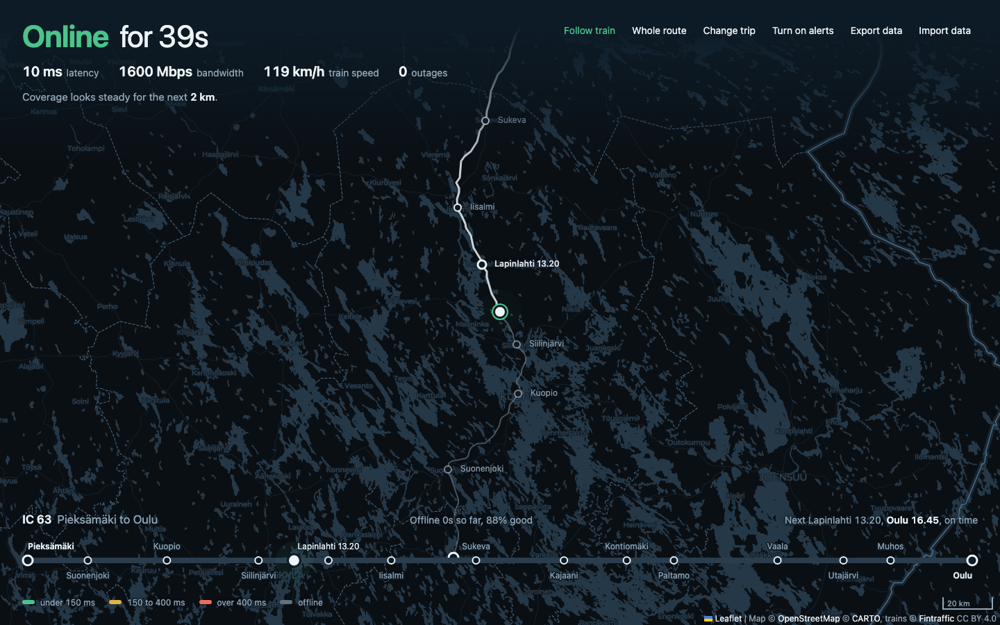

# Train netmap

A single HTML page that follows your train across Finland and records how good the mobile connection is along the way. It shows your live position, the route with every stop, the connection quality painted on the map, and a forecast of when the connection comes back based on your earlier trips.



## Features

- Live train position and speed from Fintraffic's Digitraffic API, with the real track and its stops drawn on the map. The track is the same train's GPS trail from an earlier day, so it follows the rails rather than straight lines between stations.
- A latency probe every 5 seconds and a 2 MB download test every 2 minutes, so the bandwidth figure is a real measurement rather than the browser's estimate.
- The track is painted in four colours: green under 150 ms, yellow under 400 ms, red above that, and grey when offline.
- A coverage map built from hexagons about 1.2 km wide. Every trip you log adds to it, so over time it becomes your own map of where the connection works.
- A route line at the bottom with all stops, the next stop and its time, delay, and the connection quality for each stretch you have travelled.
- A forecast line: "Connection should be back in about 4 min", "Dead zone in about 2 min, lasting about 3 min", "Faster connection in about 6 min". It uses the coverage from your earlier trips on the same stretch, so it has nothing to say on a line you have not travelled before.
- Browser notifications when the connection comes back, when it gets faster, when a dead zone is coming up and when the connection is expected back.
- Map tiles along the route ahead are fetched while you are online, so the map keeps working in dead zones.
- Everything is saved in the browser. Export writes every trip to one JSON file, and Import merges such a file back in on another browser.

## Setup

1. Copy `config.example.js` to `config.js`.
2. Get a free basemap key from [CARTO](https://carto.com/basemaps) and put it in `config.js`. Without it the page works but the map background stays dark.
3. Open `index.html` in Chrome or Chromium. The bandwidth estimate shown before the first download test uses `navigator.connection`, which only exists in Chromium browsers; everything else works in Firefox and Safari too.

Pick your departure and arrival stations and the train fills itself in. You can also type the train, as `IC 63`, `IC63` or `63`. A trip can be preset in the address: `index.html?train=63&from=PM&to=OL`, using Digitraffic's station codes.

`config.js` is ignored by git, so your key stays on your machine.

## Offline

The page is built to keep working in dead zones. Leaflet is included in the repository, and the station list, the timetable, the track and every sample are kept in the browser, so a trip that was set up once comes back without a connection. Map tiles along the route ahead are fetched while online.

Opened straight from the file, tiles rely on the browser's own cache. To have them cached for certain, serve the folder over http and open that address once while online:

```
python3 -m http.server 8080
```

Then open `http://localhost:8080/`. A service worker takes over and keeps the page and every tile it has seen.

## Data sources and requests the page makes

- Train positions, timetables and the track: [Fintraffic Digitraffic](https://www.digitraffic.fi), licensed CC BY 4.0. Positions are fetched every 15 seconds, within Digitraffic's limit of 50 requests per 5 minutes. The track is one request per train, the train's positions from an earlier day, and is cached.
- Map tiles: [CARTO](https://carto.com) basemaps on OpenStreetMap data.
- Latency probe: `cp.cloudflare.com/generate_204`, about 300 bytes every 5 seconds.
- Bandwidth test: `speed.cloudflare.com`, 2 MB every 2 minutes while online.

Nothing else leaves the browser. The samples, trips and coverage map live in the browser's local storage for this page.

## Limitations

- The position comes from the train, so it works on Finnish trains that report GPS to Digitraffic, which is most of VR's passenger trains.
- While offline, the position is estimated by moving along the track at the speed of the last known fix, so the grey stretches on the map can be off by a few hundred metres.
- The bandwidth test measures download only.
- Local storage holds a few megabytes. A full day of samples is about half a megabyte, so export your data now and then if you travel a lot. The page warns when storage is full.

## License

MIT, see `LICENSE`.
